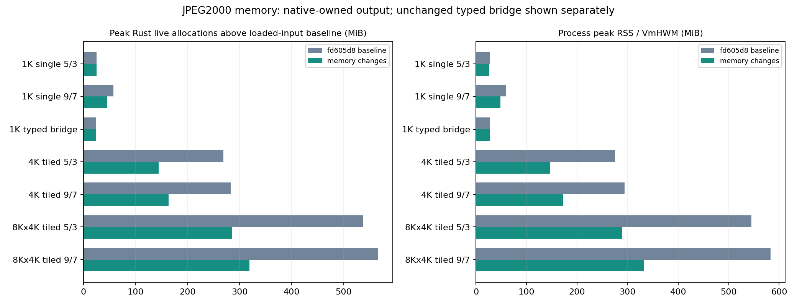
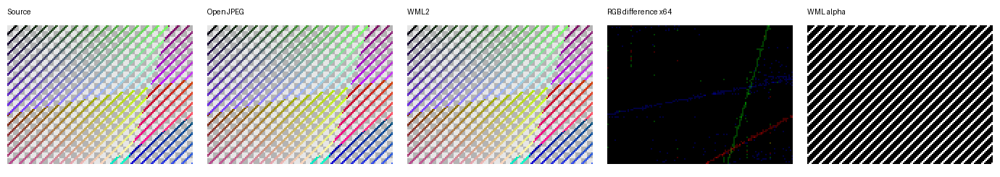

# JPEG2000 EX buffer lifetime and native owned output (WML2 0.0.37)

This continuation starts at PR #16 head
`fd605d82347c80ba7ac7cd05ac56b5b6a917ae13` on the separate
`codex/jpeg2000-ex-memory-20261017` branch at WML2 0.0.36.
This records the original pre-publication checkpoint; the capability is
included in [WML2 0.0.37](releases/0.0.37.md).

The EX 9/7 reconstruction releases each integer coefficient vector after its
last reader, before inverse DWT. Reversible EX still needs its integer samples
for packing and retains them. Legacy 8-bit reconstruction keeps its established
allocation/drop order. The checked workspace budget remains conservative and
unchanged; this change does not widen accepted inputs or raise default limits.

The byte-slice `image_from_ex[_with_limits]` convenience route adopts a completed
JPEG2000 canvas when requested storage matches its declared native format.
The private constructor validates the supplied bytes through the existing EX
initialization rules, preserves Exact/Round policy and source declaration, and
transfers the Vec without another full-frame allocation/copy. Other storage
formats keep guarded callback conversion. All decoding and input validation
still finish before public callbacks. The private input Vec now expires when
full decoding returns, before callback delivery or owned-result adoption.
The caller's input remains borrowed and the decoder still reads the whole
compressed input into its private Vec.

No public API, sample math, precision policy, metadata contract, callback order,
byte stride, accepted alpha profile, resource threshold or Cargo dependency
changes. Unsigned Gray12/16 and RGB/declared straight RGBA12/16 remain packed
little-endian bytes. This is buffer lifetime work; reduced-resolution decoding,
spatial ROI and streaming are separate work.

## Memory measurements

The standalone Linux probe uses a counting allocator only in the probe binary,
never in WML2. It records requested live allocation bytes separately from
process VmHWM/RSS and cgroup memory. Peak extra live bytes are measured above
the already-loaded input baseline; total live bytes and baseline are retained
in the raw report. Requested bytes exclude allocator metadata/fragmentation and
are not an RSS estimate. Cgroup values include caches and other processes.

OpenJPEG 2.5.3 generated 22 deterministic 12/16-bit Gray/RGB/RGBA streams,
5/3 and 9/7, ramp/noise, single and tiled, in four increasing stages:
1024², 2048×1536, 4096² and 8192×4096. The paired immutable-base/current
matrix has 272 fresh-process observations covering 80 configurations, including
native owned, collecting/discarding callbacks, storage conversion and HighRes
bridges. Stages 1/2 use two alternating pairs; stages 3/4 use one pair. Every
accepted pair has identical packed output hashes; 5/3 also equals its source.
These are single-host observations, not universal memory/performance bounds.

The full matrix was recorded at `b8d90cf284ffb5e40c63de0171be96730a555be3`.
The final refinement restores legacy allocation order without changing EX
processing; representative final-binary measurements require identical live
peaks and output hashes, including both largest streams and null-effect cases.
Binary hashes, commands and per-observation measurements are in the artifacts.

Representative native RGBA16 results, MiB (base → current):

| Input / route | Peak extra live allocation | Process peak RSS |
| --- | ---: | ---: |
| 1024² single tile, 5/3 owned | 25.22 → 25.22 | 26.64 → 26.48 |
| 1024² single tile, 9/7 owned | 57.62 → 45.60 | 59.89 → 47.92 |
| 1024² tiles 256, 5/3 HighRes bridge | 24.00 → 24.00 | 26.64 → 26.74 |
| 4096² tiles 512, 5/3 owned | 268.50 → 144.76 | 275.14 → 147.05 |
| 4096² tiles 512, 9/7 owned | 282.73 → 163.80 | 294.01 → 172.06 |
| 8192×4096 tiles 512, 5/3 owned | 537.08 → 285.41 | 544.93 → 288.96 |
| 8192×4096 tiles 512, 9/7 owned | 565.67 → 318.82 | 582.93 → 332.97 |

Single-tile reversible reconstruction still dominates the peak, so avoiding a
later canvas copy does not lower its peak. Some Gray 9/7 cases show little/no
peak improvement. The typed HighRes bridge still overlaps packed bytes,
intermediate U16 samples and the returned typed Vec (about three canvases).
Converted storage still uses callbacks; compressed-input expiry can help its
peak but no same-format Vec transfer applies. Full input, full output canvas
and tile working storage remain. No streaming or bounded-RSS claim is made.

The 4096² single-tile controls still fail at default limits. The accepted
controls explicitly raise expanded-byte budget to 3 GiB; they do not use
unlimited limits. Builds use two jobs and supervised measurements stop their
own process above 12 GiB cgroup usage on this 16 GiB environment. OOM events
remain zero.

## Pixel, contract and platform verification

The new four-test integration suite checks all 400 existing high-depth streams
against the callback route under both precision policies, all six storage
formats, input/pixel/expanded/frame/metadata/animation budgets, exact expanded
thresholds, declaration/stride/policy preservation, post-failure scope cleanup,
truncation/unsupported inputs, huge origins and overflow. Unit tests prove Vec
pointer identity and validate byte length/12-bit high bits and storage budgets.
The immutable base comparison separately requires byte-exact output on all
400 streams; numerical tolerances cannot hide a changed decoded sample.

Two actual Node/WASM builds (minimal/default, overflow checks enabled, no
imports) each execute all 400 streams plus 12 rejection controls, with extra
conversion/limit/large-origin cases. The i686 Linux library/tests compile;
Windows i686 CI explicitly executes the four new tests. Existing Gray, colour
and 9/7 WASM suites retain their independent reference comparisons.

OpenJPEG and FFmpeg's native JPEG2000 decoder independently check 18 staged
large images, including both 8192×4096 streams. Reversible output is exact;
9/7 remains within the established OpenJPEG maximum difference of four and
FFmpeg maximum difference of one source-depth sample. The largest 9/7 means
are 0.186611 and 0.005015 respectively. No codec mathematics changed.

Counts overlap and must not be added:

| Release configuration | Passed / failed / ignored |
| --- | --- |
| Workspace JPEG2000 + EX + high-bit-depth + AVIF encoder | 520 / 0 / 14 |
| Minimal JPEG2000 + EX library/tests | 143 / 0 / 0 |
| Focused EX + high-bit-depth library and four EX targets | 54 / 0 / 0 |
| Legacy JPEG2000 library/regressions, EX disabled | 75 / 0 / 0 |

Clippy completes with existing repository warnings. Benchmarks retain raw
paired samples and output hashes, including the initial legacy timing concern
and the follow-up after restoring its allocation order. Final 16-pair legacy
median deltas are +4.43% Gray32, +1.63% RGB32 and +0.84% RGBA16. The final
EX-disabled release example has byte-identical `.text` (609786 bytes) and
`.rodata` sections to the immutable base; these timing observations do not
support attributing the differences to changed legacy instructions/data.
The complete eight-pair EX benchmark also retains its individual results.
Timing variation is not a conformance guarantee or a claim that every input
becomes faster.

## Reproduction and evidence

Enable `jpeg2000,image-buffer-ex` and run `--test jpeg2000_ex_memory`.
The scripts in `wml2-test/scripts/` are:

- `verify_jpeg2000_ex_memory_wasm.py`: actual WASM execution.
- `generate_jpeg2000_ex_memory.py --work-dir .test-memory-fixtures --stage N`:
  staged OpenJPEG fixtures (also specify `--compress /path/to/opj_compress`).
- `jpeg2000_ex_memory_probe.rs`: standalone Linux allocator/RSS probe. Build
  separate base/current probe projects and target directories against their
  respective immutable checkouts with the same source and features.
- `measure_jpeg2000_ex_memory.py --base BINARY --current BINARY --manifest PATH
  --work-dir .test-memory-measurements --stage N`: paired resumable measurements.

The [validation JSON](jpeg2000-ex-memory-validation.json) links the completed
checks, memory summary and hashes. The [compressed raw report](jpeg2000-ex-memory-raw.json.gz)
contains every measurement, fixture manifest, independent comparison, benchmark
sample and relevant log. The committed preview is a display check, while raw
sample comparisons establish numerical correctness.
