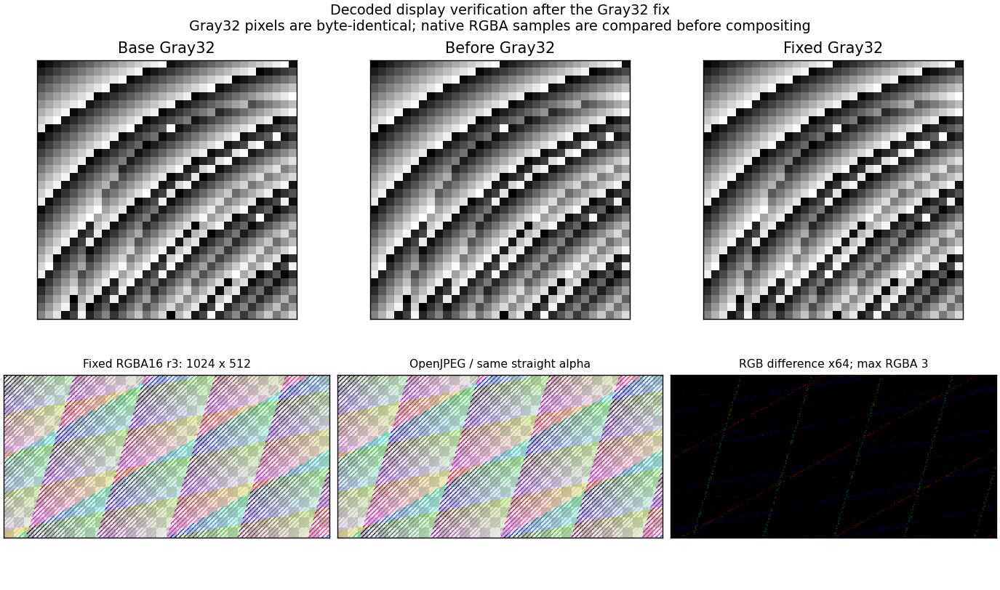

# Gray32 JPEG2000 performance regression follow-up

The investigated checkpoint is `3d81b951d700af92784830e821bd7c79a8ca8cba`; the baseline is memory PR #17 head `bc6c1182c7478c385b10296af71c996c4f4f3ab7`. The original +8.17% Gray32 median slowdown is retained as evidence. The checkpoint source archive and release binaries were saved with SHA-256 hashes before any experiment. WML2 remains 0.0.36.

The adopted change reuses the existing bounded, statically typed midpoint MQ reader only for one style-zero segment with at most 24 internal bit planes. It preserves geometry/pass validation, empty-segment padding and error text. All other styles, multiple segments and 25–28 internal bit planes use the source-identical generic fallback. Output sample depth remains the established profile; this does not add a 24-bit output API. Both existing MQ kernels and all public entry points are unchanged.

A differential unit test compares the new dispatch with the unchanged generic reader across partial passes, all four orientations, 16/17-pixel boundaries, internal precisions through 28 bits, empty/padded/malformed MQ data and invalid bounds/pass counts. Independent image references then verify the complete decoder. No new codec arithmetic, quantization, colour conversion or alpha handling is introduced.

The final controlled Gray32 comparison rebuilt all three sources at the same source path in separate fresh Cargo targets. Each reproduced its saved binary byte-for-byte, with identical dependency locks and Rust 1.91.0. All variants execute via one staged pathname with exactly the same argv. A supervisor uses CPU 1; the worker is pinned to CPU 0 or 2. There are 12 balanced four-variant blocks per CPU, each process timing 10,000 public API decodes after the same warmups. The A/A control executes the exact baseline binary again. No codec build or profiling runs concurrently.

| CPU | Base us/decode | A/A base repeat | Before fix | Fixed | Fixed vs base | Fixed vs before | A/A vs base |
| --- | ---: | ---: | ---: | ---: | ---: | ---: | ---: |
| 0 | 338.11 | 347.10 | 360.95 | 344.58 | +1.91% | -4.54% | +2.66% |
| 2 | 328.11 | 339.19 | 359.04 | 334.34 | +1.90% | -6.88% | +3.38% |

The observed Gray32 excess time returns to the A/A repeatability band on these two CPUs. This is a practical measured improvement, not a formal equivalence or universal no-regression guarantee. Paired-block bootstrap intervals are broad: the fixed-versus-base 95% intervals are -5.89% to +8.23% (CPU 0) and -4.43% to +10.77% (CPU 2). Combining the byte-identical base/control slots gives point differences +0.55% and -0.54%; the report retains both reference choices and all intervals. The earlier saved-binary comparison also measured fixed time changes of -1.23%/-0.09% versus base and -7.68%/-4.85% versus the checkpoint.

The baseline/checkpoint instruction profiles explain why this was not treated as an 8% increase in algorithmic work: total executed instruction count differs by about +0.0033%, and normalized instruction streams/local jump offsets of the dominant Tier-1 and MQ bit functions are identical after removing relocations. Their addresses and the surrounding general-decoder code generation differ. Native code-generation/layout/latency sensitivity plus measured environmental variation is the supported inference. A native hardware instruction-counter open returned ENOENT, so cache versus branch-prediction contributions cannot be directly attributed on this VM.

The adopted reader reuse reduces modelled indirect branches from 5,864,608 to 3,206,512 and data references from 415,202,965 to 377,971,976 in the same 301-decode Callgrind workload. Instruction count increases about 2.55%. These are instrumented/modelled counts; Callgrind elapsed time is not used as a native speed result. The change targets avoidable per-symbol generic dispatch and state-access overhead rather than padding code to obtain a favourable address.

Three rejected candidates and every adverse result remain in the raw archive:

| Candidate | CPU 0 time vs base | CPU 2 time vs base | Decision |
| --- | ---: | ---: | --- |
| Restore packet borrow/evaluation order | +7.28% | +0.36% | Reject: does not improve CPU 0 |
| Static entropy dispatch once per pass | +6.28% | +3.66% | Reject: CPU 0 worsens; instructions +3.8% |
| Add AXIS 16/1024 specialization | +9.61% | +23.20% | Reject after four-block screening on each CPU; instructions +4.85% |

The packet/static candidates each have 12 balanced blocks per CPU; the AXIS screen has four. Their source and timing data are retained, and none of these changes is included in production. The adopted candidate is a narrower reuse of an existing decoder.

An additional 504-observation comparison covers seven existing API profiles, with 12 balanced three-variant blocks per CPU, identical staged executable path/arguments and output hashes. Positive numbers below mean more time:

| Profile | Fixed vs base CPU 0 | Fixed vs base CPU 2 | Fixed vs checkpoint CPU 0 | Fixed vs checkpoint CPU 2 |
| --- | ---: | ---: | ---: | ---: |
| Gray32 | -2.76% | -2.18% | -4.66% | -4.25% |
| RGB32 | +2.78% | +3.89% | +3.69% | +0.90% |
| RGBA16 | -3.23% | -2.77% | -4.91% | -8.15% |
| Gray53EX12 | -4.04% | -2.76% | -3.00% | -4.84% |
| RGBA97EX12 | -3.57% | -4.15% | -8.00% | -4.21% |
| Gray53EX16 | -6.48% | -2.26% | -5.46% | -4.37% |
| RGBA97EX16 | -3.17% | -0.81% | -3.39% | -3.75% |

RGB32 has positive point estimates in the short-loop check, so it received one predeclared longer-loop follow-up: 12 four-variant blocks per CPU, 10,000 iterations, identical staged path/argv and A/A control. No extra repeat was selected to replace an unfavourable result. The longer-loop results are:

| CPU | Base us/decode | A/A repeat | Checkpoint | Fixed | Fixed vs base | Fixed vs checkpoint | A/A vs base |
| --- | ---: | ---: | ---: | ---: | ---: | ---: | ---: |
| 0 | 247.58 | 246.85 | 248.65 | 252.47 | +1.97% | +1.54% | -0.30% |
| 2 | 256.34 | 269.25 | 277.64 | 270.35 | +5.47% | -2.63% | +5.04% |

The RGB32 fixed-versus-base 95% paired-block intervals are -3.44% to +4.25% and -2.46% to +13.15%; both include zero. CPU 2 has a +5.04% A/A shift. These results do not establish unchanged RGB32 speed, nor a repeatable additional slowdown. The positive estimates and broad uncertainty are retained as a limitation rather than omitted.

Validation passes: minimal JPEG2000 150 tests; focused high-bit-depth 61; workspace 527 with the existing 14 ignored; legacy-only 81. Clippy passes with the same warning headers as the previous checkpoint. EX and non-EX Linux i686 compile checks pass. Actual host-import-free wasm32 execution passes 1,309 references in both minimal-EX/default configurations and 152 in legacy-only, including 423/423/23 explicit-zero comparisons, contract/overflow checks and the updated Tier-1 source hash.

All 96 large reduced outputs again match OpenJPEG and FFmpeg and are byte-identical to the checkpoint output. Reversible 5/3 remains exact against both readers; irreversible source-sample maxima remain 4 against OpenJPEG and 1 against FFmpeg. Six fresh before/fixed memory pairs (12 processes) cover Gray32, 1024-square Gray16 and 8192 x 4096 tiled RGBA16, at reduction 0 and 2. Every pair has identical output and peak extra requested live bytes. This includes 334,308,630 bytes for the largest full 9/7 result and 73,802,886 bytes at reduction 2. RSS and instrumented times are recorded separately and are not substituted for native timing evidence.

The Gray32 images are byte-identical. The large straight-alpha RGBA16 image was compared in source-domain samples before compositing; scaling is only for display. The maximum displayed RGBA sample difference against OpenJPEG is 3.

Cargo uses two build jobs. The supervisor stops its own process group above 12 GiB in the 16 GiB cgroup. The maximum recorded cgroup usage was below 9 GiB and all OOM/OOM-kill counters remain zero. No stop or connection failure occurred in this follow-up.

[Machine-readable validation and confidence intervals](jpeg2000-gray-regression-validation.json) and [compressed raw evidence](jpeg2000-gray-regression-raw.json.gz) retain all 1,076 new timing/memory process observations, previous reported measurements, rejected candidate sources, instruction profiles, scripts, hashes, logs, large comparisons and wasm reports. Final pushed-head CI and the actual Windows i686 differential-test execution proof are checked separately after push; the CI workflow now includes that dedicated test.

Public API, explicit reduction-zero compatibility, storage/byte-stride/Exact/Round/straight-alpha contracts and the reduced-profile limits remain unchanged. Multi-tile-part PPT, discarded entropy validation, ROI/streaming and the other previously documented exclusions are not expanded. AVIS remains unguaranteed. No new PR, merge, publish, version bump, tag/release or upstream codec change is part of this work.
