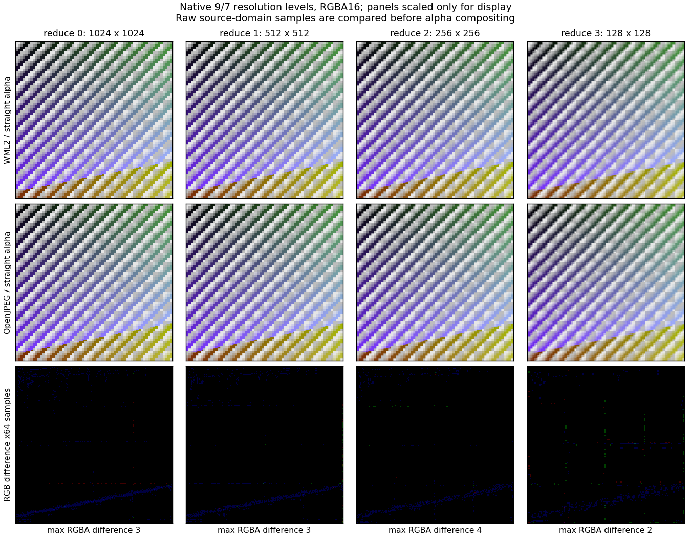
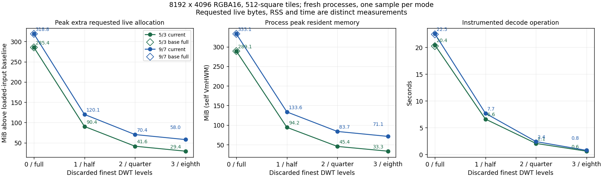

# Native JPEG2000 resolution reduction (WML2 0.0.37)

The measurements below describe the pre-Gray-fix implementation checkpoint
`e4e7dbd52100b75b271fb143c99fe6a488091ff1`. The subsequent
[Gray32 performance follow-up](jpeg2000-gray-regression.md) retains the reported
slowdown and records the narrower MQ-reader correction, controls and limitations.

This continuation starts at memory PR #17 head
`bc6c1182c7478c385b10296af71c996c4f4f3ab7` on
`codex/jpeg2000-reduced-decode-20261017` at WML2 0.0.36. The APIs are
included through PR #18 in [WML2 0.0.37](releases/0.0.37.md).

Existing entry points and `DecodeOptions` / `DecodeLimits` struct literals are
unchanged. Three codec-specific opt-in functions accept a discarded DWT level
count and explicit limits:

- `jpeg2000::decode_with_reduction(reader, callback_options, reduce, limits)`
  returns ordinary RGBA8 for the reduced 8-bit profile.
- `jpeg2000::decode_ex_with_reduction(...)` retains the native high-depth EX
  source declaration and bytes.
- `jpeg2000::image_from_ex_with_reduction(bytes, storage, precision, reduce,
  limits)` returns owned EX storage, moving a matching native canvas or using
  guarded Exact/Round conversion for another format.

Explicit zero delegates the established full-resolution dispatch, including
its broader legacy acceptance. Existing calls with no reduction remain full
resolution. Nonzero reduction discards the finest `reduce` DWT levels; it does
not decode a full image and resize it.

## Reduced profile and geometry

Nonzero reduction accepts uniform unsigned full-resolution Gray/RGB/explicitly
declared straight RGBA at 8 bits (ordinary RGBA8), or 12/16 bits (Gray12/16 or
RGBA12/16 packed little-endian EX bytes). Classic reversible 5/3 and bounded
9/7/ICT are supported; existing 9/7 maximum six levels remains. Colour and alpha
are never premultiplied. RGB adds opaque alpha at the source bit depth.

Signed/mixed precision, subsampling, HT, encoded maxshift ROI, palette/CMAP,
sYCC/ICC and implicit/premultiplied/per-colour alpha are outside this reduced
profile and are explicitly rejected. Multi-tile-part PPT is also explicitly
unsupported: the existing full-resolution per-part parser is preserved. Single-
tile-part PPT and multi-part PPM/inline headers are independently covered.
The existing strict EX channel declaration
rules also apply to nonzero 8-bit reduction. MCT requires equal colour-component
DWT level counts. Each used tile/component must have at least `reduce` levels;
values above 32 and an empty global result are rejected before callbacks.

For scale `f = 2^reduce`, output bounds are
`[ceil(x0/f), ceil(x1/f)) × [ceil(y0/f), ceil(y1/f))`.
The width is not generally `ceil((x1-x0)/f)`. Each component/tile uses the same
endpoint rule; a tile whose reduced output collapses still has all its packets
consumed and checked. Packet/block ordering uses original reference-grid
geometry. Reduced coefficient planes retain only the required low resolutions,
original quantization entries and `levels-reduce` inverse lifting stages, with
reduced absolute origins. DC shift, colour transform, final rounding/clamping
and source-depth packing then follow the established sample rules.

## Validation and resource contract

Every packet header, tag tree, pass/segment state, progression change and
payload extent is processed, including discarded resolutions. Tile-part and
packet completeness still precede callbacks. Discarded high-resolution entropy
is not retained or Tier-1 decoded, so the new reduced entry points do not claim
to verify that entropy. Retained entropy and all structural/length errors remain
checked. Existing full-resolution validation remains unchanged.

Original source pixels, input bytes, frame and metadata budgets are retained;
reduction cannot bypass the source pixel limit. Expanded budgets cover reduced
canvas/component/working storage plus full-resolution block/header/progression
state. Retained segment bytes are charged before allocation with a conservative
capacity allowance. Discarded payload is checked for extent without charging
it as an owned copy. Header state can dominate a deeply reduced result; a
smaller output does not guarantee acceptance under a tight expanded budget.
These logical budgets are not a process RSS bound. All input and the output
canvas remain in memory; spatial ROI and streaming are separate work.

The independent corpus contains 1,309 OpenJPEG 2.5.3 `opj_decompress -r`
PGX outputs, including all supported reductions from the existing high-depth
fixtures and the five-progression, multi-layer 8-bit corpus. Reversible samples
are exact. Current reduced 9/7 differences peak at 1/1/3 source samples for
8/12/16 bits; full-resolution reference tolerances are unchanged. This corpus
includes odd origins, singleton outputs and collapsed output tiles. OpenJPEG's
9/7 encoder asserts on nine nonzero one-pixel edge-tile profiles; these are
excluded from successful encoding counts. Nine separately documented zero-
entropy derived controls independently decode all 27 reduced empty-tile outputs.

The fixture manifest, packed reference blob and compressed per-case provenance
are in `wml2/tests/fixtures/review/jpeg2000-reduced-*`. Regenerate with
`generate_jpeg2000_reduced.py --compress /path/to/opj_compress --decompress
/path/to/opj_decompress --work-dir .test-reduced-references`.

`jpeg2000_reduced_verify` exports actual native-resolution bytes and times
complete public-API decodes. Example:

```sh
cargo run -p wml2 --release --no-default-features \
  --features jpeg2000,image-buffer-ex --example jpeg2000_reduced_verify \
  -- INPUT.jp2 OUTPUT.u16le 2 16 4
```

The input bit depth/component count select the example output; the library
validates actual declarations. The retained evidence and measurements below describe this implementation checkpoint.


## Independent pixel and platform checks

The committed small corpus has 1,309 reduced OpenJPEG references: 152 at 8 bits,
567 at 12 bits and 590 at 16 bits. Native Rust and actual wasm32 execution use
these same packed bytes and check source-domain samples before storage conversion.
All reversible references require exact equality, rather than a filename-based
filter guess. The 9/7 maxima are 1, 1 and 3 source samples respectively.

A second corpus covers 32 streams, from 1024-square Gray/RGB/RGBA at all three
supported bit depths and both filters to 8192 x 4096 tiled RGBA16. Its 96 native
reduced outputs each match both OpenJPEG `-r` and FFmpeg's native JPEG2000
`-lowres` decoder within the retained source-domain thresholds. Every reversible
comparison is exact; observed maxima over the irreversible large corpus are 4
samples against OpenJPEG and 1 against FFmpeg. These are observed differences,
not an expanded guarantee for arbitrary irreversible input.



The display check uses straight RGBA16 composited over the same checkerboard.
Each panel is scaled only for presentation; the raw arrays are compared first.
The third row exaggerates RGB sample differences by 64. Alpha differences are
included in the numerical maximum even though the third row displays only RGB.

The local suites pass with these totals:

| Configuration | Passed | Ignored |
| --- | ---: | ---: |
| JPEG2000 minimal, without EX | 149 | 0 |
| JPEG2000 + EX focused high-depth suites | 60 | 0 |
| Default workspace | 526 | 14 |
| Legacy-only selected configuration | 80 | 0 |

Clippy passes with existing warnings, and both EX/non-EX Linux i686 compile
checks pass. Actual wasm32 runs have
no host imports, retain release overflow checks and pass 1,309 references in
both minimal-EX and default configurations, plus 152 in legacy-only mode.
The EX runs additionally compare all 423 explicit-zero inputs; the legacy run
compares 23. Each run exercises contract and discarded-packet checks, including
actual 32-bit offset/geometry overflow behavior. Windows i686 CI executes the
six reduction test bodies, alongside the existing EX suites.

The contract checks include byte stride, native source declaration, Exact/Round,
straight alpha, source/output/expanded limits, large absolute origins, empty
output tiles, excessive reduction and failure before callbacks. The packet
corpus covers five progressions, layers, SOP/EPH, PLT/TLM, POC, single-part PPT,
multi-part PPM/inline, chunked packed headers, segmentation/BYPASS, COC/QCC,
per-component levels without MCT and per-tile level overrides. Mutated discarded
packet lengths/headers are rejected. Deliberately poisoned discarded MQ entropy
can leave the reduced output unchanged, consistent with the stated guarantee.
A valid multi-part PPT negative control independently decodes with OpenJPEG but
is explicitly rejected by the nonzero WML2 API.

## Live memory, RSS and instrumented time

The baseline is immutable memory PR #17 head
`bc6c1182c7478c385b10296af71c996c4f4f3ab7`. Baseline and current binaries use
separate Cargo targets and identical dependency locks. Measurements run in fresh
processes, on one pinned worker CPU with the supervisor on another CPU. The
standalone probe wraps the system allocator to count requested live allocation
bytes; this instrumentation is absent from the production library. Its baseline
is taken after loading input. Process peak RSS is recorded independently and is
not interchangeable with requested live bytes. The timed public decode operation
includes atomic allocation accounting and excludes writing the result file.

There are 300 observations over 170 configurations / 32 streams, including
34 stream/budget variants. Stages 1–2 use two alternating baseline/current pairs;
stages 3–4 use one pair. The 60 baseline/current full-resolution pairs have
identical acceptance, output hashes and peak extra live bytes. This proves the
measured allocation result, not instruction identity or a universal speed bound.
The probe records live bytes after dropping the result: all 294 accepted
observations return to the loaded-input baseline. The six rejected observations
still own their 54/56-byte diagnostic strings when that counter is sampled.

For the largest 8192 x 4096 RGBA16 case with 512-square tiles:

| Filter | Mode | Dimensions | Peak extra live MiB | Process RSS MiB | Instrumented seconds |
| --- | --- | --- | ---: | ---: | ---: |
| 5/3 | Baseline full | 8192 x 4096 | 285.41 | 289.10 | 20.250 |
| 5/3 | Current full | 8192 x 4096 | 285.41 | 289.14 | 20.448 |
| 5/3 | Reduce 1 | 4096 x 2048 | 90.39 | 94.19 | 6.605 |
| 5/3 | Reduce 2 | 2048 x 1024 | 41.61 | 45.41 | 2.054 |
| 5/3 | Reduce 3 | 1024 x 512 | 29.38 | 33.29 | 0.606 |
| 9/7 | Baseline full | 8192 x 4096 | 318.82 | 333.05 | 22.447 |
| 9/7 | Current full | 8192 x 4096 | 318.82 | 333.15 | 22.534 |
| 9/7 | Reduce 1 | 4096 x 2048 | 120.07 | 133.56 | 7.686 |
| 9/7 | Reduce 2 | 2048 x 1024 | 70.38 | 83.67 | 2.397 |
| 9/7 | Reduce 3 | 1024 x 512 | 57.98 | 71.05 | 0.758 |



These largest-mode timings are one sample each. The different slopes and
nonzero floor reflect retained whole input, full geometry/header state and the
reduced canvas; neither memory nor time is promised to fall by exactly four
per discarded level. RSS can also be lower than requested allocation capacity
when pages remain untouched.

Both full decoders reject the 4096-square single-tile RGBA16 controls under the
existing default expanded budget. Nonzero reduction 1 also rejects these two
controls conservatively because block state dominates; reductions 2/3 succeed.
The same streams, including full and reduction 1, succeed under the explicit
3 GiB expanded-budget controls and their reduced pixels independently match.
The library does not silently relax the user's limits. The supervisor monitors
the 16 GiB cgroup, stops its probe at 12 GiB and keeps builds at two Cargo jobs;
all recorded cgroup OOM/OOM-kill counters remain zero.

## Uninstrumented paired speed checks

Release example binaries separately time the public API without allocator
instrumentation. Eight alternating baseline/current process pairs use the same
input and iteration count per case. Output hashes match. The median results are:

| Existing API case | Baseline us/decode | Current us/decode | Time change |
| --- | ---: | ---: | ---: |
| Gray32 legacy | 333.58 | 345.16 | +3.47% |
| RGB32 legacy | 245.56 | 247.17 | +0.66% |
| RGBA16 legacy (8-bit samples) | 257.26 | 258.37 | +0.43% |
| Gray 5/3 EX12 | 5169.53 | 5249.43 | +1.55% |
| RGBA 9/7 EX12 | 16517.32 | 16688.92 | +1.04% |
| Gray 5/3 EX16 | 6312.54 | 6333.74 | +0.34% |
| RGBA 9/7 EX16 | 20369.58 | 20227.61 | -0.70% |

The small Gray32 result warranted a targeted check: 12 further alternating
pairs, each with 10,000 iterations, measured 331.75 versus 358.86 us/decode
(**+8.17% current time**). Both distributions overlap, but the repeated slowdown
is retained as a performance concern rather than dismissed as noise or hidden
by the faster reduced cases. The binaries' text sections differ; instruction
identity is not claimed. This single-host result does not establish a universal
regression size, and the continuation cannot claim that every existing profile
has unchanged speed. The [Gray32 performance follow-up](jpeg2000-gray-regression.md) addresses this
checkpoint result with a narrow reuse of an existing MQ reader. It retains all
these observations, rejected candidates, A/A controls and confidence intervals;
no universal no-regression claim is made.

Using one current reduced example, eight alternating ascending/descending level
sweeps time each case with the same iteration count at all four levels:

| Native RGBA input | Reduce 1 speedup | Reduce 2 speedup | Reduce 3 speedup |
| --- | ---: | ---: | ---: |
| 8-bit 5/3, odd 33 x 29 | 5.38x | 18.69x | 37.48x |
| 8-bit 9/7, odd 33 x 29 | 6.00x | 19.77x | 36.81x |
| 12-bit 5/3, 1024-square | 3.15x | 9.58x | 32.52x |
| 12-bit 9/7, 128 x 96 | 3.66x | 12.10x | 36.79x |
| 16-bit 5/3, 1024-square | 3.08x | 10.39x | 33.01x |
| 16-bit 9/7, 128 x 96 | 3.66x | 12.69x | 38.84x |

These ratios compare the current public reduced entry point against its
explicit-zero mode for the same stream. They are not cross-filter comparisons
and do not imply a fixed speedup for other images. The raw evidence retains
minima, maxima, all individual samples, commands and binary hashes.

## Reproducibility and boundaries

[Validation summary](jpeg2000-reduced-validation.json) contains source hashes,
configuration counts, benchmark summaries and the raw archive hash.
[Compressed raw evidence](jpeg2000-reduced-raw.json.gz) retains every memory
observation, paired timing sample, both independent-reader comparisons, fixture
provenance, validation logs, wasm reports and local orchestration scripts.

The committed standalone tools in `wml2-test/scripts/` are
`generate_jpeg2000_reduced_memory.py`, `jpeg2000_reduced_probe.rs`,
`measure_jpeg2000_reduced.py` and `verify_jpeg2000_reduced_large.py`. They are
validation tools; production builds do not install an allocator or profiler.
`verify_jpeg2000_reduced_wasm.py` executes the committed shared contract tests
in a host-import-free wasm module. Temporary work roots must start with `.test`.

This is native resolution reduction, not spatial ROI or streaming. Full input
and global canvas remain resident; discarded entropy is not fully validated.
No new formats, subsampled paths, HT/ROI, animation, AVIS guarantee, EX8 acceptance,
upstream codec edits, dependency updates or changes to established full-resolution
entry points are included. The measurements retain their original pre-release
checkpoints; PR #18 includes this continuation in WML2 0.0.37.
